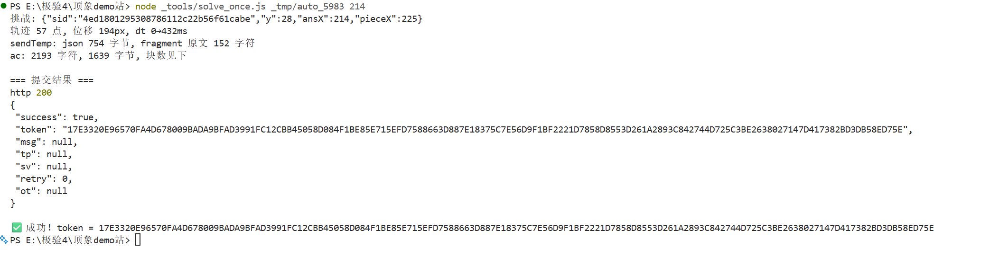

# 顶象官网 demo 站 · 逆向笔记

从零开始重做 demo 站的滑块。hb56（`captcha.gdtspace.com`）那条线因为云端风控暂时放弃，
理由和过程记在 `../顶象/` 那边的笔记里；这份文档只讲 demo。

> 本文档里带 ✅ 的是**已经抓包 / 实际造包验证过的事实**。
> 全文已无未验证项（2026-10-23 更新）；被推翻的早期推测保留在第 4.1 节，明确标注了。

---

## 1. 目标

| 项目 | 值 | 状态 |
|---|---|---|
| demo 展示页 | `https://www.dingxiang-inc.com/business/captcha` | ✅ |
| 验证码接口 | `https://cap.dingxiang-inc.com` | ✅ |
| `ak` | `99de95ad1f23597c23b3558d932ded3c` | ✅ |
| `jsv` | `5.1.53` | ✅ |
| `ac` 前缀 | **每 build 变**：5971 → … → 5983（2026-10-23） | ✅ 见 `build_对比记录.md` |
| 风控 | **无**，位置对了直接 `success:true` | ✅ |

> **`ac` 前缀不是常量。** 它就是 SDK 版本号，一天两次定时构建（`10:00` / `19:00`）就会跳。
> 任何把这个数写死的地方都会在换 build 后失效。当前值从 `dx_config.json` 的 `version` 读。

**和 hb56 的关系：** 同一个产品、同一套交互，但是**不同版本的 SDK**。

- hb56：`jsv=v1.4.0(81)`，ac 前缀 `s_v3#`，接口域名 `captcha.gdtspace.com`
- demo：`jsv=5.1.53`，ac 前缀随 build 变（`5971#` → … → `5983#`），接口域名 `cap.dingxiang-inc.com`

所以 `../顶象/滑块参数破解/构造ac.js` **不能直接拿来用**，ac 的编码层要重新对。

**demo 的用途边界：** demo 没有接风控，`success:true` 只证明「算法和轨迹格式被 SDK 接受」，
**不能**当作「能过线上风控」的证据。

**目标已达成 ✅**：demo 链路已于 2026-10-23 端到端跑通，详见第 9 节。

---

## 2. 通信流程

浏览器一次完整的验证（✅ 抓包确认）：

```
1) GET  /udid/c1                    ← 设备认证，拿设备 token
   resp: {"data":"<40位 token>","msg":"The token is valid.","status":1}
          status=1 表示复用已有 token，status=2 表示新签发

2) GET  /api/a?...                  ← 拉一次挑战会话
   resp: {sid, y, o, p1(背景图 url), p2(拼图块 url), cid, ...}

3) GET  /api/p1?...&imageType=0     ← 背景图
   GET  /api/p1?...&imageType=1     ← 拼图块

4) 前端本地计算：还原背景 → 定位缺口 → 造 ac

5) POST /api/v1                     ← 提交
   body: ac, ak, c, jsv, sid, aid, x, y, w, h   （10 个字段）
   resp: {"success":true,"token":"<128 hex>","msg":null,"tp":null,"sv":null,"retry":0,"ot":null}
```

**`/udid/c1` 这一步可以完全跳过**（✅ 2026-10-23 实测）：本地造包只走
`GET /api/a` → `POST /api/v1`，从不调用 `/udid/c1`，照样 `success:true`。
所以它的 `Param` 头怎么加密，对本项目没有影响，不必再查。

（hb56 上它是两步：先 OPTIONS 再 GET，带一个加密的 `Param` 请求头。）

---

## 3. 提交表单（11 个字段）

✅ 2026-10-23 本地造包成功的那一次（build 5983，完整现场在 `_tmp/auto_5983/`）：

```
ac  = 5983#...                              (2193 字符 / 1639 字节)
ak  = 99de95ad1f23597c23b3558d932ded3c
c   = 6ad7147ck7swOQgPxDDLO3KaEaIebxwzJu1kTRF1
jsv = 5.1.53
sid = 4ed1801295308786112c22b56f61cabe
aid = <每次从 /api/a 响应取>
uid = ""                                    (空串，但字段要带上)
x   = 214
y   = 28
w   = 380
h   = 165
```

实际提交是 **11 个字段**：`ac ak c uid jsv sid aid x y w h`。

最早的 5971 版样本（`../顶象/数据/ipreq/demo_v1.json`，2649 字符，x=157 y=47）也仍然有效，
只是 `ac` 前缀变了 —— 字段名和格式没动过。注意 `c` 这个值会变（页面上的常量，偶尔换）。

**和 hb56 表单的差异：**

| 字段 | hb56 | demo | 说明 |
|---|---|---|---|
| `w` / `h` | 无 | `380` / `165` | demo 多这两个，是挑战图的**渲染**尺寸（不是图片像素 400×200） |
| 其余 | 同 | 同 | `ac ak c uid jsv sid aid x y` |

请求头（✅）：`accept: */*`、`content-type: application/x-www-form-urlencoded`、
`origin`/`referer` 都是 `https://www.dingxiang-inc.com`。

---

## 4. ac 格式

> 以下 6 条 2026-10-23 已全部用 JS + 实际造包确认（✅）。原先是猜测，现在留结论。

**整体格式：**

```
ac = <version>#<自定义 base64( 拼接后的 ua 字节串 )>
```

`version` 就是 `ua` 前缀那个整数（5971 / 5976 / 5983 …），**每 build 变**，不是常量。

**6 条确认结果：**

1. ✅ **base64 字母表**就是 hb56 那一张，一字不差：
   `XmYj3u1PnvisIZUF8ThR/a6DfO+kW4JHrCELycAzSxleoQp02MtwV9Nd57qGgbKB=`
   （5976 → 5977 → 5980 → 5981 → 5983 五个 build **全都没换**。所以不能用它判断
   "是不是新 build"，要看版本号或文件 hash。）
2. ✅ **分块结构**确实是 `[1字节 type][大端2字节 len][payload]`，没有额外校验位。
3. ✅ **init 块顺序**确实是 `TM BR LO CF DI EM JSV TK`（8 块）；如果构造时触发了
   屏幕信息采集，后面还会跟一块 `SC`（9 块）。**顺序固定，变的是每块的 type 号。**
4. ⚠️ **轨迹块不是固定 `type=17`。** 每个轨迹点 = 一块，type 号每 build 重洗
   （5983 的 `sendSA` 是 2）。加密族也不定，5983 是周期 9 的 XOR，别的 build 见过
   chain / perm。**必须按语义查配置，不能写死 type 或加密方式。**
5. ⚠️ **离散事件也不是固定的 11/12。** 对应的语义是 `getFO`（焦点）、`getTC`（触摸）、
   `getTMV`（触摸移动），type 号同样每 build 变。
6. ✅ **x / y 不是 ac 里的块**，它们是 POST 表单字段；而 `sendTemp` 块里那串 JSON
   （含页面指纹 + `x` / `y` / `fragment`）就是结果块。

**18 个语义 ↔ type 号是每 build 的 1..18 一个置换**，加密也只有三种族
（`xor` / `chain` / `perm`）。完整的跨 build 对照表见 **`build_对比记录.md`**。

hb56 那边解出来的东西都在 `../顶象/滑块参数破解/轨迹解码.py`，可以拿来当对照的起点——
它把 ac 拆成「头部 9 块 + 离散事件 + 轨迹」，先拿它去解 demo 的 ac，看能不能解出来、
解出来像不像，就能快速判断两版差多少。

### 4.1 拿老解码器试解 demo 的 ac（历史记录，已被推翻）

> **这一小节是拿到 JS 之前的猜测，结论已经被第 4 节的实测推翻，保留只为记录过程。**
> 当时以为「type 号固定」，所以按 hb56 的 `type=17` 去数块，得出的 type 分布毫无意义。
> 实际情况是 **每 build 把 1..18 重新分配给 18 个语义**，同一个 type 号在不同 build
> 指的是不同的块。

把 `demo_v1.json` 里那条 ac 喂给 `轨迹解码.py` 的 `b64dec` + `split_chunks`：

```
ac 2649 字符 → b64 解出 1983 字节 → 分块 96 个
demo 的 type 分布: {1:1, 2:1, 3:8, 5:74, 7:1, 8:1, 11:3, 12:2, 14:1, 15:1, 16:1, 17:1, 18:1}
hb56 的 type 分布: {1:1, 2:1, 3:1, 4:1, 5:1, 6:2, 7:1, 8:1, 9:1, 10:1, 11:6, 12:1, 17:111}
```

**结论：能解但明显不是同一套结构。** 具体差异：

- hb56 的 `type=5` 只有 1 块，demo 有 **74 块**
- hb56 的轨迹是 111 个 `type=17`（每点一块）；demo 的 `type=17` 只有 1 块，
  但有一个 **738 字节的 `type=18`**——轨迹大概率整段压进了 18
- demo 出现了 hb56 没有的 `type=14/15/16/18`
- hb56 有 `type=4/6/9/10`，demo 没有

**⚠️ 一个必须注意的坑：** 字母表用 `REV` 查表，只要 64 个字符都在表里就不会报错——
所以「解码没抛异常」**不能**证明字母表和 hb56 相同。如果 demo 用的是同一组字符的
**另一种排列**，照样能解出来，但全是乱码。上面这些「type 分布」要等拿到 JS 确认
字母表之后才算数，**现在只当线索，别当结论**。

当时判断「`构造ac.js` 基本要重写」——**这个判断是对的**，最终结果就是本目录的
`主要算法.js`：不照搬 hb56，而是把"每 build 变的部分"全部外置成 `dx_config.json`。

---

## 5. 图片还原与缺口定位（✅ 已跑通）

### 5.1 乱序表从哪来 —— demo 和 hb56 不一样

✅ **demo 的 `/api/a` 响应里没有 `o` 字段。**

hb56 是靠响应里的 `o`（如 `3758d419e72e636ce145b99395c7ed3e`）还原切片的。
demo 的响应字段是：

```
sid, cid, y, p1, p2, p3, type, logo, logoSwitch, tp1, cw, sc1, icons,
verifyType, childVerifyType, imgName, color, chs, ot, tk1, speed1, speed2,
bgUrl, sliderUrl, sliderBarUrl, extra, success, msg, t, result, bc
```

没有 `o`。所以**乱序表只能从别处来**。

### 5.2 假设：乱序表藏在 p1 的文件名里

✅ 实测两次拿到的 p1 文件名，都是 **32 位 hex**：

```
/dx/h1F6YALAEw/zib3/41fe5d5cb17547d58663359b374319c3.webp
/dx/AMwt6OSpxO/zib3/f8ae905c043243a6b0f6a57d19e903a2.webp
                        ^^^^^^^^^^^^^^^^^^^^^^^^^^^^^^^^
                        32 个字符 ↔ 32 片
```

**32 个字符对应 32 片**——跟 52pojie 那篇说的 `get_arr_32`（从 p1 文件名取乱序表）对得上。
✅ 已确认（见 5.4）：不是直接按字符取，中间那一步是 **`charCode % 32`，撞了就 `+1`
直到不重复**，所以结果一定是 0..31 的排列。

### 5.3 还原算法（✅ 已确认并跑通）

前端那段 drawImage 循环（当时扣码的 `图片回复.js` 已删，逻辑就是下面这段；现成的实现在 `图片还原.py`）：

```js
o.drawImage(t, r, 0, c, e, i * a, 0, c, e)
```

9 参数版 `drawImage` 是「从源图抠一块贴到目标」：

```
ctx.drawImage(img, sx, sy, sWidth, sHeight, dx, dy, dWidth, dHeight)
                  └r   0     c        e     i*a   0    c        e
```

因为 `sWidth == dWidth`、`sHeight == dHeight`，**没有缩放，是纯搬运**。读成人话：

> 目标第 `i` 片 ← 源图第 `table[i]` 片

也就是按乱序表把切片搬回原位。各参数取值：

| 参数 | 值 | 说明 |
|---|---|---|
| `t` | 源图 | HTMLImageElement |
| `r` | `table[i] * 12` | 源 x，**唯一有信息量的变量** |
| `c` | `12` | 片宽（= `a`） |
| `e` | `200` | 片高 = 整图高 |
| `i*a` | `i * 12` | 目标 x |
| 循环 | `i` 遍历 32 片 | |

### 5.4 乱序表算法（✅ `get_arr`）

从 **p1 文件名**（32 位 hex）算出一个 0..31 的排列：

```js
for (var d = 0; d < n.length; d++) {
    var u = n.charCodeAt(d);
    if (32 === d) break;              // 最多取 32 个字符
    for (; c.includes(u % 32);) u++;  // 撞了就 +1 直到不重复
    c.push(u % 32);
}
```

**逐字符取 charCode → 对 32 取余 → 撞了就 +1**。所以结果一定是 0..31 的排列。

实测（`98c49d59e3c544ebb03aadc8262720a1`）：

```
[25, 24, 3, 20, 26, 4, 21, 27, 5, 19, 6, 22, 23, 28, 7, 2,
  8, 16, 29, 1, 9, 10, 11, 30, 18, 31, 0, 12, 13, 17, 14, 15]
```

### 5.5 实测结论

| 项 | 结果 |
|---|---|
| 图尺寸 | `400 × 200`（表单里的 `w=380 h=165` 是**渲染尺寸**，不是像素尺寸） |
| 切片 | **32 片 × 12px = 384px**（缝全在 12 的倍数上，实测确认） |
| 拼图块 | `68 × 68` RGBA |
| 还原效果 | 边界/片内 列差比 **3.35 → 1.09**（缝基本愈合） |

**一个待解释的点：** 图是 400 宽，但只切 384（32×12），**最后 16px 不参与乱序**。
不影响还原（那 16px 原样保留，看着是连续的），但要知道有这回事。

**注意：** `../顶象/恢复.py` 的 `restore_session()` 是**按 `resp.json` 的 `o` 字段**
还原的，demo 没有 `o`，所以那个函数**不能直接用**。已经重写为
`顶象demo站/图片还原.py`（`get_arr` + `restore`，附缝愈合度自检）。

### 5.6 缺口定位（✅ 已搬过来并跑通）

`../顶象/缺口.py` **能用在 demo 上**，已搬到 `顶象demo站/缺口.py`。
核心的 `bright_map` / `candidates` **一行没改**，改的只是「喂进去的东西」。

**三条线索在 demo 上的结论和 hb56 完全一致：**

| 线索 | hb56 | demo | 结论 |
|---|---|---|---|
| `ncc_map`（看内容） | 无效 | **无效** | 顶象把坑内容整个换掉，不是只压暗一层 |
| `chamfer_map`（看轮廓） | 只能定位不能判别 | 未试（两个坑轮廓一样，没必要） | |
| `bright_map`（看明暗） | **有效** | **有效** | 真坑 0.35~0.57，别处 >0.78 |

ncc 在 demo 上的实测：多尺度掩码 `TM_CCOEFF_NORMED`（对整体压暗免疫），
最高才 **0.648**、多数落在 0.40~0.50 —— 就是噪声水平。所以「看内容找坑」
这条路在 demo 上也是死的，**别去碰**。

**实测结果**（两组样本）：

```
样本1  y_resp=39  雪山湖
  #1  ratio=0.542  块左上=(286, 53)   ← 真坑，暗方块
  #2  ratio=0.662  块左上=(335,101)   ← 右侧暗岩坡，地形
  #3  ratio=0.773  块左上=(149, 53)   ← 诱饵（倾斜的灰白方块）

样本2  y_resp=42  云层
  #1  ratio=0.387  块左上=(195, 58)   ← 真坑（用户肉眼确认红框正确）
  #2  ratio=0.676  块左上=(290, 85)   ← 浅灰圆角方块（诱饵）
  #3  ratio=0.792  块左上=( 47,134)   ← 云里的暗块
```

两组 `#1` 都明显跑赢 `#2`（样本2 是 0.387 vs 0.676，差距很大）。但**样本1 的 `#2`
只有 0.662，比 hb56 那边的「别处 >0.78」低**——那张图右边整片是暗岩坡，暗地形多。
所以 **y 带限制在 demo 上比 hb56 更要紧**，不能只看全图最暗。

**注意：块形状每组都不一样。** 样本1 不透明区 47×50（画布内偏移 `(10,8)`），
样本2 是 63×51（偏移 `(2,8)`）。所以**不能把块尺寸写死**，得每组从拼图块图
（`/api/p1?...imageType=1` 下回来那张，本地叫 `piece.webp`；早期手工存的那份叫
`font.webp`，已删）的 alpha 现算。

**⚠️ 坑 1：框比坑大一圈 —— 拼图块有透明边距**

拼图块图是 **68×68 画布，但真正不透明的只有 47×50**（左 10、上 8、右 11、下 10）。
掩码用 alpha 本身是对的（透明处是 0，不参与均值），但**报坐标时必须加回这个偏移**，
否则会以为「框比坑大」。`缺口.py` 现在两个坐标都报（`画布=(x,y)` 和 `块=(x,y)`）。

**⚠️ 坑 2：demo 多了一个「诱饵方块」，它根本不是坑**

图上有个**倾斜的、灰白的、带柔和阴影的圆角方块**（约 x 140~195, y 50~100）。
它不像 hb56 那种「另一个坑」，更像图层水印之类的东西，ratio 只有 0.773，排第 3。
hb56 那边是「一暗一亮的两个坑」，demo 这边结构不完全一样，**别照搬 hb56 的
「两个坑」心智模型**。

**y 的坐标系：响应坐标 × 4/3 = 图像坐标**（✅ 10 组样本，带内命中 10/10）

demo 的 `/api/a` 里 `y` 和图像像素**不是 1:1**（实测排除：`y_resp=71` 的图，
坑顶在图像 y≈88，不是 71）。最合理的解释是**服务端在 300×150 这个"标准坐标系"
里算的，客户端放大到 400×200**：

| | 图像 | 拼图块 |
|---|---|---|
| hb56 | 300×150 | 50×50 |
| demo | 400×200 | 68×68 |
| 比 | **4/3** | ~4/3 |

#### 10 组样本实测（当时的 `采样.py 10`，y 跨度 28~71；该脚本已删）

用 `缺口.py` 现有逻辑（`4/3 ± 10`）逐组跑：

| 样本 | `y_resp` | 带内块 y | ratio | 全图块 y | 全图 ratio | 带内=全图? |
|---|---|---|---|---|---|---|
| 01 | 71 | 88 | 0.528 | 88 | 0.528 | ✓ |
| 02 | 51 | 69 | 0.433 | 69 | 0.433 | ✓ |
| 03 | 28 | 41 | 0.524 | 103 | 0.396 | ✗ |
| 04 | 28 | 41 | 0.438 | 103 | 0.185 | ✗ |
| 05 | 55 | 77 | 0.516 | 77 | 0.516 | ✓ |
| 06 | 67 | 86 | 0.483 | 86 | 0.483 | ✓ |
| 07 | 70 | 91 | 0.521 | 91 | 0.521 | ✓ |
| 08 | 47 | 57 | 0.427 | 57 | 0.427 | ✓ |
| 09 | 49 | 67 | 0.346 | 67 | 0.346 | ✓ |
| 10 | 51 | 62 | 0.389 | 18 | 0.334 | ✗ |

**结论 1（这条最重要）：带内 #1 在 10/10 组上都压在真坑上。**
把每组的带内 #1 裁出来放大 2.5 倍逐格看（`_crop.png`），10 格全是
"暗色填充的块状缺口"，没有一格跑到地形上去。**y 带这条路是通的。**

**结论 2：全图最暗只有 7/10 对。** 03/04 被暗色地形骗走，10 被相机镜头骗走
（`ratio` 甚至低到 0.185/0.334 —— 比真坑还"暗"）。**所以 y 带是必需的，
不能只看最暗**，这点比 hb56 更要紧。

**结论 3：4/3 的残差散布 ±8px。** 逐组算 `4/3*y_resp − 块y`：

```
-6.7  +1.0  +3.7  +3.7  +3.7  -3.3  -2.3  -5.7  +1.7  -6.0
```

均值 −1.0，标准差 3.9，最大 6.7 —— **全部落在 `±10` 带内**。

对带内这 10 组做最小二乘，得到 `块y ≈ 1.16*y_resp + 7.8`（标准差 3.2），
比 4/3 略好一点点，但**这个拟合是被 y 带"喂"出来的（带心就是 4/3），
有偏，不能当作独立证据**。两个模型在 `±10` 带内都能罩住真坑，所以
`缺口.py` **保留 4/3**（物理依据硬），`Y_SEARCH=10` 吸收模型误差。

✅ **2026-10-23 用真提交钉死了：`y` 根本不用算。**

`y` 就是 `/api/a` 响应里那个值，**原样回传**，服务端自己校验（我们试过 28，直接拿响应的
28 提交就过）。所以这条 4/3 的换算只用于**在图上圈定搜索带**（`缺口.py` 的判断依据），
不参与提交。

`x` 的换算链倒是要精确：

- `x_ans = round(块左边 × 380/400)`，两次真机样本验证：块 181 → 172、块 285 → 271
- 位移 = `x_ans - 20`（20 = 40px 手柄宽的一半）
- **容差约 ±5px**：214 成功；另一组 276 失败、271 成功，就差 5

**注意：`w=380 h=165` 和这个没关系**（400/200=2.0，380/165=2.30，不是等比），
别拿它去算缩放。

### 5.7 每张图都有"一暗一亮两个形状"

10 组样本**无一例外**，每张图都有两个形状：一个是**暗色填充的缺口**，
另一个是**同形状的半透明"幽灵"**（在同一 y 高度、x 不同，看着像水印/预览）。
真坑是**暗的那个**，`bright_map` 找的也是它。别把幽灵当成第二个坑。

**注意：块形状每组都不一样。** 10 组的块尺寸在 `52x47` ~ `65x65` 之间，
`by0`（画布内上边距）在 `2` ~ `10` 之间。所以**绝对不能把块尺寸写死**，
必须每组从拼图块图（`piece.webp`）的 alpha 现算。

---

## 6. 已有的样本

**本目录内（推荐用这些）：**

| 路径 | 内容 |
|---|---|
| `_tmp/auto_5983/` | ✅ 2026-10-23 本地造包成功那一次的完整现场：`bg.webp`、`piece.webp`、`infor.json`（`/api/a` 响应）、`answer.json`、`marked.png`（缺口标注图）、`ac_win.txt`、`token.txt` |
| `_tmp/trajectory_success.json` | ✅ 真机手拖的一条 57 点轨迹（造包时按比例缩放复用） |
| `_tmp/sendtemp_tpl.json` | ✅ `sendTemp` 的页面指纹模板 |
| `_tmp/html_prefix.txt` | ✅ 页面 HTML 前 200 字符（`fragment` 的来源） |
| `dx_config.json` | ✅ 当前 build（5983）的完整外壳配置 |

**外部老工程 `../顶象/数据/ipreq/`（早期资料，仍可参考）：**

| 文件 | 内容 |
|---|---|
| `demo_v1.json` | demo 最早一次**成功**的提交包（`5971#`，含完整表单 + token 响应） |
| `imgs.json` | 那次的 p1/p2 图片（base64） |
| `api_a.json` | `/api/a` 的响应 |
| `a_all.json` / `c1_all.json` | hb56 的 `/api/a`、`/udid/c1` 完整请求记录（协议格式参考） |

---

## 7. 开工清单（全部完成 ✅）

- [x] **1. 存 SDK** —— 已被更好的做法取代：每次 build 现场 dump 一份配置，
      见 `_tools/dump_build.js` 和 `build_对比记录.md`
- [x] **2. 抓样本** —— 真机拖拽 2 次 + 本地造包 5 次，共 7 次 `success:true`
- [x] **3. 解 ac** —— 字母表 / 分块 / 头部顺序 / 轨迹块全部确认，见第 4 节
- [x] **4. 对照** —— 结论：语义层（方法名、块顺序、明文字段布局）稳定，
      **标签层（type 号、版本、加密表）每 build 全换**，所以做成外置配置
- [x] **5. 重写生成器** —— 产出 `主要算法.js` + `_tools/dump_build.js`
- [x] **6. 端到端跑通** —— 见第 9 节

---

## 8. 文件与环境

工程根目录 `E:\极验4\顶象demo站`（本文档就在根目录）。

**核心（运行必需）**

| 文件 | 作用 |
|---|---|
| `主要算法.js` | 扣出来的算法主体：`process` / `app` / 各 `get*` / `sendSA` / `sendTemp`。**换 build 不用改这个文件** |
| `dx_config.json` | 当前 build 的外壳配置，由 `dump_build.js` 生成 |
| `图片还原.py` | 背景图还原（`get_arr` 从 p1 文件名算乱序表 + `restore`） |
| `缺口.py` | 缺口定位（`bright_map` 等） |

**工具 `_tools/`**

| 脚本 | 作用 |
|---|---|
| `dump_build.js <greenseer.js> <out.json>` | 从 SDK 文件生成当次 build 的配置 |
| `probe_challenge.js [目录]` | 离线拿挑战 + 下图片 + 算缺口 → `answer.json` |
| `gap_candidates.py` | 三检测器（bright/rim/edge）合并候选 |
| `gap_rim.py` | 单独的亮环检测器（兜底调试用） |
| `solve_once.js <目录> [x]` | 拼 ac + sendTemp，提交一次 |
| `solve_auto.js [次数]` | 全自动跑一轮，逐个候选试到 success |

**数据 `_tmp/`**：`trajectory_success.json`、`sendtemp_tpl.json`、`html_prefix.txt`
三个模板**与 build 无关，长期有效**；`auto_5983/` 是成功现场留档。

**文档**

- `逆向笔记.md` —— 本文，逆向过程与结论
- `build_对比记录.md` —— 五个 build 的 type / 加密族 / 函数名逐项对照

**外部老工程** `..\顶象\`（hb56 线，仅作代码参考）：`滑块参数破解\轨迹解码.py`、
`构造ac.js`、`_capture_ac.py`。demo 线已经不需要它们。

**依赖**：Node.js（无 npm 依赖，全用内置模块）；Python 3 + `opencv-python`、`numpy`、
`Pillow`。

**注意事项（从 hb56 带过来的经验）：**

- 抓包 Chrome **绝不开 Debugger 域**——顶象的 `debugProtection` 会把页面冻死。
  用只开 `Page`/`Network`/`Runtime` 的自写 CDP。
- 一次只发**一个**验证包，别循环、别并发。
- 定位缺口时别只信分数排序，深色物体（门框之类）和重复形状会把 #1 骗走，
  要用 `y` 对得上 + 人眼看图交叉验证（`marked.png` 那套）。

---

## 9. ✅ 端到端跑通（2026-10-23，build 5983）

本地纯离线造包、不依赖浏览器，一发 `POST /api/v1` 拿到 token：



那一次的完整数据：

| 项 | 值 |
|---|---|
| 命令 | `node _tools/solve_once.js _tmp/auto_5983 214` |
| build | 5983（`greenseer_10_23.js`） |
| `sid` | `4ed1801295308786112c22b56f61cabe` |
| `y`（服务端给，原样回传） | 28 |
| 拼图块左边（图片像素） | 225 |
| 答案 x = 225 × 0.95 | **214** |
| 轨迹 | 57 点，位移 194px，`dt` 0→432ms |
| `sendTemp` | json 754 字节，`fragment` 原文 152 字符 |
| `ac` | 2193 字符 / 1639 字节 |
| 结果 | `success: true`，`retry: 0` |

现场留档在 `_tmp/auto_5983/`（`bg.webp`、`piece.webp`、`answer.json`、`marked.png`、
`ac_win.txt`、`token.txt`），可当回归样本。

**这条链路覆盖了什么：**

1. `_tools/dump_build.js` 从 greenseer.js 出当次 build 的配置（type 号 / 加密表 / base64）
2. `_tools/probe_challenge.js` 离线拿 sid + y + 两张图
3. `缺口.py` / `_tools/gap_candidates.py` 算缺口 → `x_ans = 块左边 × 0.95`
4. `主要算法.js` 用配置 + 真实轨迹模板拼出 `ac` 和 `sendTemp`
5. `_tools/solve_once.js` 提交

各 build 之间到底变了什么，见同目录 `build_对比记录.md`。
